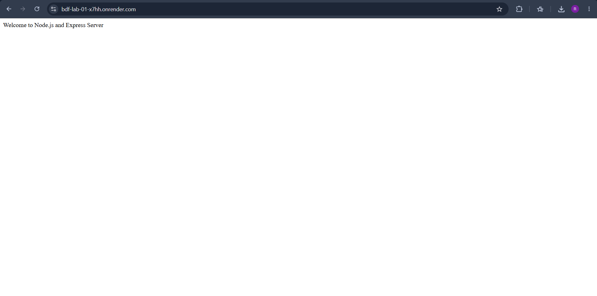
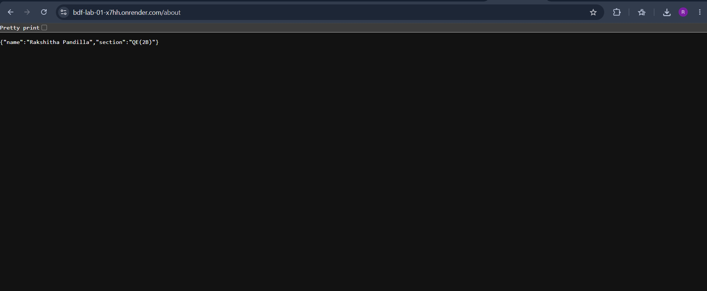
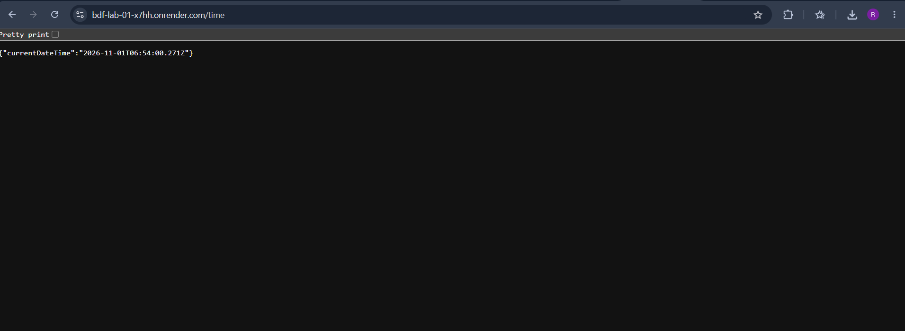
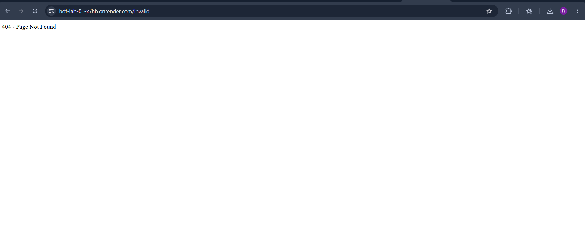

# Lab 1: Node.js and Express Server

## Live Deployment

**Deployment URL:** https://bdf-lab-01-x7hh.onrender.com/

## GitHub Repository

**Repository:** https://github.com/rakshithapandillap-hash/Rakshitha_Pandilla

---

## Student Details

- **Name:** Rakshitha Pandilla
- **Registration Number:** 252U1R8069
- **Section:** 204 (QE-2B)
- **Course:** Backend Development Fundamentals
- **Faculty:** Mr Chintakrindi Sai Siva Teja

## Objective

To set up a Node.js project and build a web server using the built-in HTTP module and Express.js. The lab demonstrates server creation, handling HTTP requests and responses, implementing GET routes, and managing invalid routes with appropriate HTTP status codes.

## Technologies Used

- Node.js
- Express.js
- JavaScript
- Visual Studio Code
- Git and GitHub
- Render (Deployment Platform)

## Project Structure

```text
lab-01/
├── screenshots/
│   ├── home.png
│   ├── about.png
│   ├── time.png
│   └── not-found.png
├── app.js
├── server.js
├── package.json
├── package-lock.json
├── .gitignore
└── README.md
```

## Installation and Execution

### 1. Clone the Repository

```bash
git clone https://github.com/rakshithapandillap-hash/Rakshitha_Pandilla.git
```

### 2. Navigate to Lab 1

```bash
cd Rakshitha_Pandilla/lab-01
```

### 3. Install Dependencies

```bash
npm install
```

### 4. Run the Node.js HTTP Server

```bash
npm run start:http
```

The HTTP server runs at:

`http://localhost:3000`

### 5. Run the Express Server

```bash
npm start
```

The Express server runs at:

`http://localhost:3000`

## API Endpoints

The Express application provides the following GET endpoints:

| Method | Endpoint | Description | Status Code |
|---|---|---|---|
| GET | `/` | Displays the welcome message | 200 OK |
| GET | `/about` | Displays name and section in JSON format | 200 OK |
| GET | `/time` | Displays the current date and time | 200 OK |
| GET | `/invalid` | Displays the 404 Page Not Found message | 404 Not Found |

## Screenshots

### 1. Home Page


### 2. About Page


### 3. Time Page


### 4. 404 Error Page


## Deployment

The Express application has been successfully deployed using **Render**.

- **Platform:** Render
- **Service Name:** bdf-lab-01
- **Deployment URL:** https://bdf-lab-01-x7hh.onrender.com/
- **Branch:** main
- **Root Directory:** lab-01
- **Build Command:** `npm install`
- **Start Command:** `npm start`

The deployed application was tested by accessing all four endpoints.

## Notes

- Created a basic Node.js HTTP server using `http.createServer()`.
- Installed and configured Express.js.
- Implemented GET routes for Home, About, and Time pages.
- Implemented 404 error handling for invalid routes.
- Verified the HTTP status codes of all endpoints.
- Used Git and GitHub for version control.
- Deployed the Express application using Render.

## Conclusion

Successfully developed and deployed a Node.js and Express server with multiple GET endpoints and appropriate HTTP status codes. This lab provided practical experience in creating HTTP servers, handling client requests, implementing routing, managing errors, and deploying a backend application using a cloud hosting platform.