# Lab 3: REST API, Query Parameters, Validation and Debugging

**Name:** Rakshitha Pandilla  
**Registration Number:** 252U1R8069  
**Section:** 204 (QE-2B)  
**Course:** Backend Development Fundamentals

## 1. Objective

To develop a RESTful API using Node.js, Express.js and SQLite with search, sorting, pagination, price filtering, input validation, appropriate HTTP status codes and debugging.

## 2. Technologies Used

- Node.js
- Express.js
- SQLite
- sqlite3
- sqlite
- Nodemon
- JavaScript
- Postman
- VS Code

## 3. Project Structure

```text
lab-03/
├── database/
│   └── books.db
├── screenshots/
│   ├── book-not-found.png
│   ├── create-book.png
│   ├── delete-book.png
│   ├── get-all-books.png
│   ├── get-single-book.png
│   ├── invalid-query.png
│   ├── missing-await.png
│   ├── pagination.png
│   ├── port-conflict-after.png
│   ├── port-conflict-before.png
│   ├── price-filter.png
│   ├── search-books.png
│   ├── sort-books.png
│   ├── table-name-after.png
│   ├── table-name-before.png
│   ├── update-book.png
│   ├── wrong-import-after.png
│   └── wrong-import-before.png
├── db.js
├── debug-await.js
├── server.js
├── test.js
├── nodemon.json
├── package.json
├── package-lock.json
└── .gitignore
```

## 4. Installation and Execution

Install the project dependencies:

```bash
npm install
```

Start the development server:

```bash
npm run dev
```

The application runs at:

```text
http://localhost:3000
```

## 5. API Endpoints

| Method | Endpoint | Description | Expected Status |
|---|---|---|---|
| GET | `/books` | Retrieve books with optional filters | 200 |
| GET | `/books/:bookId` | Retrieve a book by ID | 200 |
| POST | `/books` | Add a new book | 201 |
| PUT | `/books/:bookId` | Update an existing book | 200 |
| DELETE | `/books/:bookId` | Delete an existing book | 200 |

## 6. Query Parameters

| Parameter | Description | Default |
|---|---|---|
| `search_q` | Search titles partially | Empty |
| `order_by` | Column used for sorting | `id` |
| `order` | Sorting direction (`ASC` or `DESC`) | `ASC` |
| `limit` | Maximum number of records | `10` |
| `offset` | Number of records to skip | `0` |
| `min_price` | Minimum price filter | No filter |
| `max_price` | Maximum price filter | No filter |

**Example request:**

```text
GET /books?search_q=Harry&order_by=price&order=DESC&limit=5&offset=0
```

## 7. Validation and Error Handling

The API validates incoming request data and query parameters.

- Missing title returns HTTP 400.
- Missing author returns HTTP 400.
- Non-numeric price returns HTTP 400.
- Negative price returns HTTP 400.
- Invalid sorting, pagination or price-filter parameters return HTTP 400.
- A nonexistent book returns HTTP 404.
- Successful creation returns HTTP 201.
- Successful retrieval, update and deletion return HTTP 200.
- Error responses use JSON messages.

## 8. Database

**Database:** SQLite  
**Database file:** `database/books.db`  
**Table:** `book`

**Columns:**

- `id` – INTEGER PRIMARY KEY AUTOINCREMENT
- `title` – TEXT NOT NULL
- `author` – TEXT NOT NULL
- `price` – INTEGER NOT NULL
- `pages` – INTEGER

Parameterized SQL queries using `?` placeholders are used for user-supplied values.

## 9. Postman Testing

The API was tested using Postman. The test cases include:

| Test Case | Method | Expected Status |
|---|---|---|
| Retrieve all books | GET | 200 |
| Retrieve a book by ID | GET | 200 |
| Retrieve a nonexistent book | GET | 404 |
| Search books by title | GET | 200 |
| Sort books by price | GET | 200 |
| Test pagination | GET | 200 |
| Filter books by price range | GET | 200 |
| Send an invalid query parameter | GET | 400 |
| Create a book | POST | 201 |
| Update a book | PUT | 200 |
| Delete a book | DELETE | 200 |

### API Testing Screenshots

**1. Retrieve All Books**

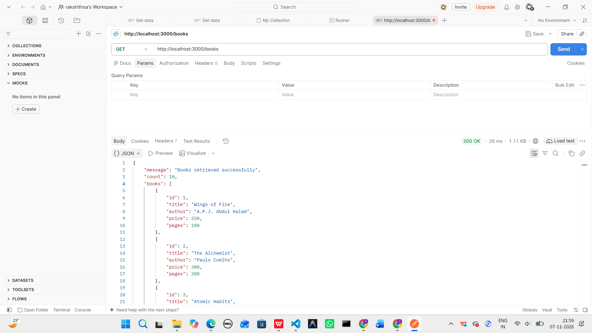

**2. Retrieve a Single Book**

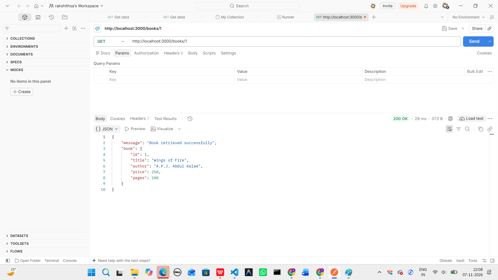

**3. Book Not Found**

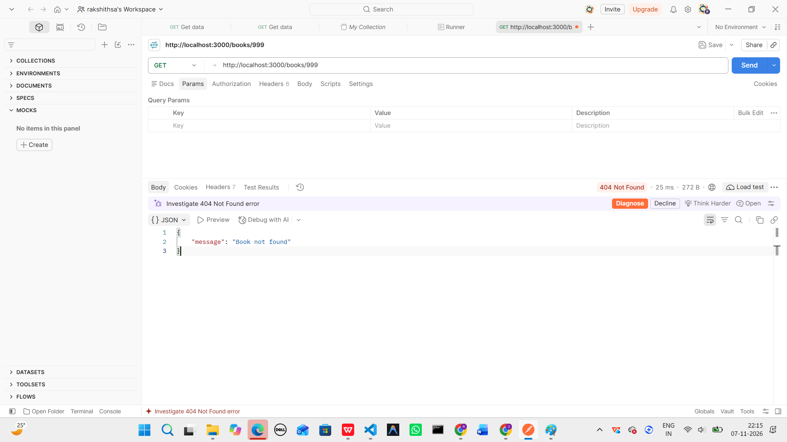

**4. Search Books**

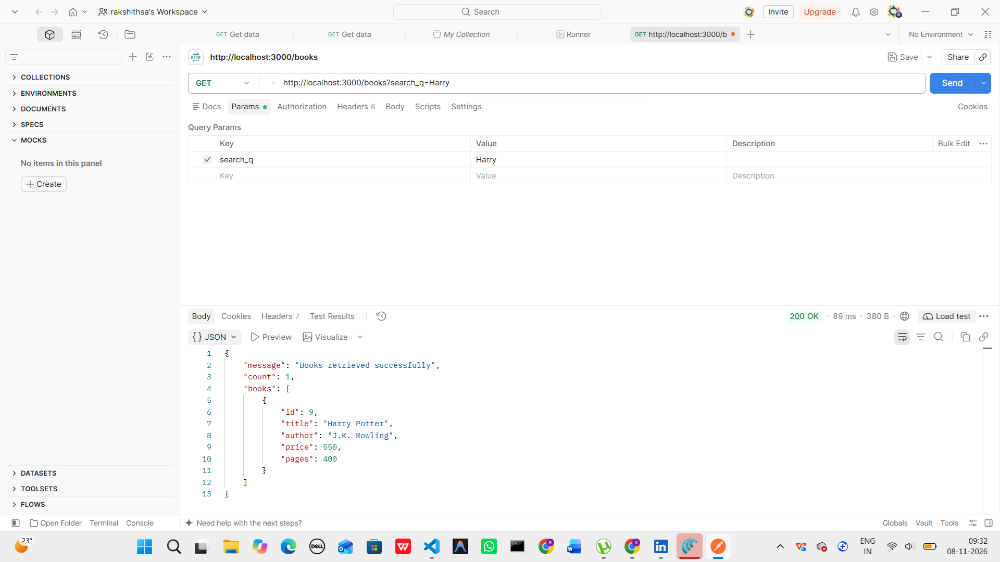

**5. Sort Books**

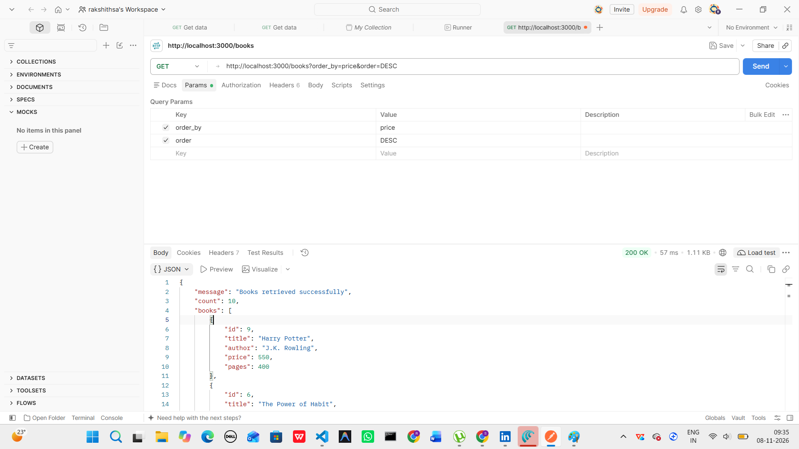

**6. Pagination**

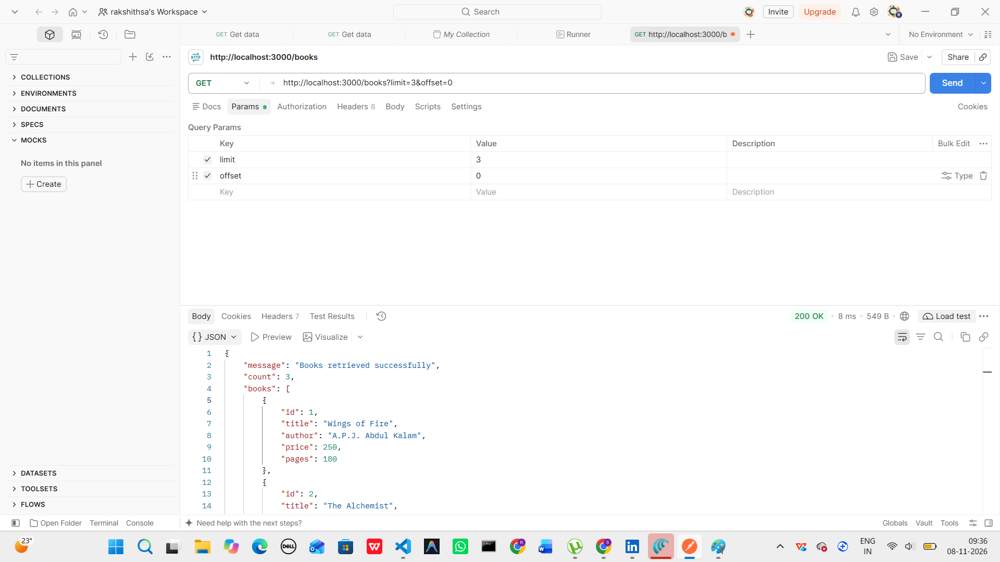

**7. Price Filter**


**8. Invalid Query Parameter**

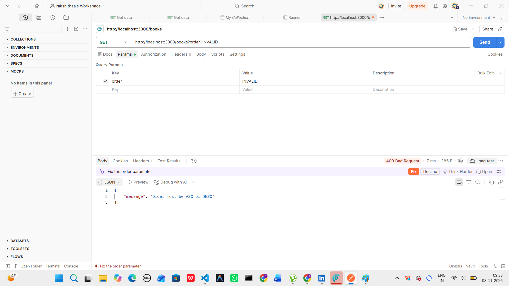

**9. Create a Book**

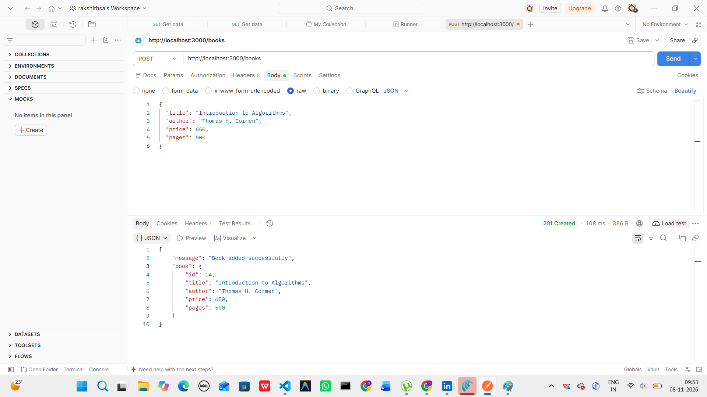

**10. Update a Book**

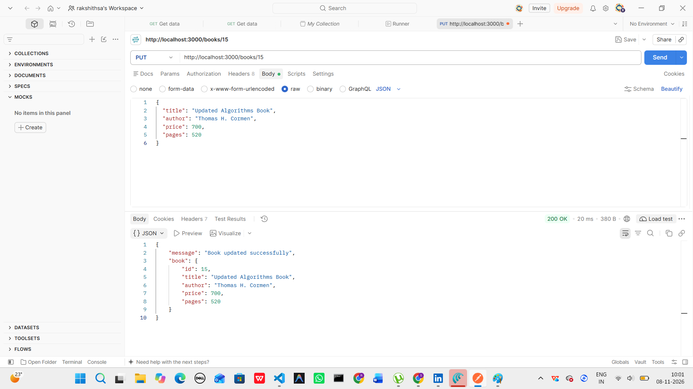

**11. Delete a Book**

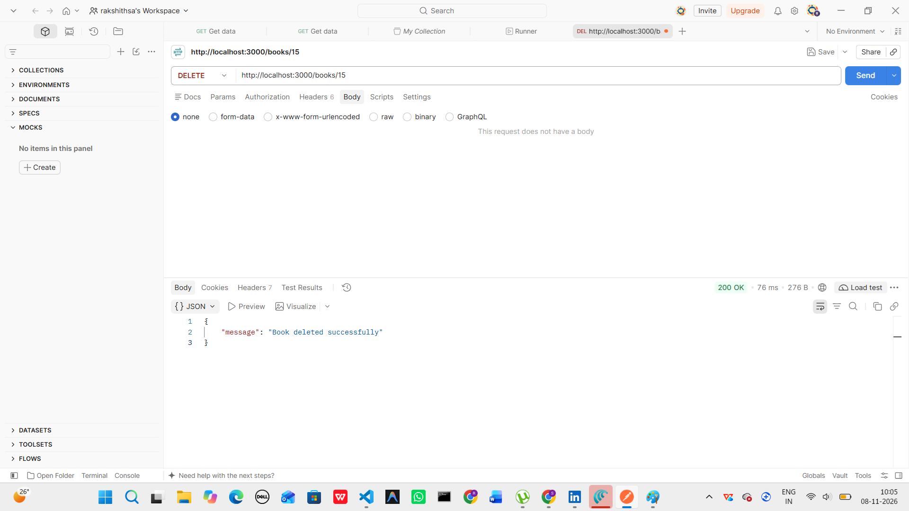

## 10. Debugging Exercises

Four debugging scenarios were reproduced and resolved.

### 1. Port Conflict – EADDRINUSE

- **Problem:** Port 3000 was already in use by another server process.
- **Solution:** Identified the port conflict and stopped the duplicate server process.

**Before fixing:**

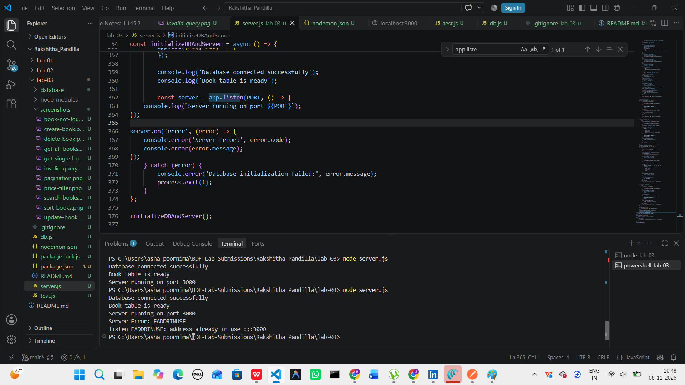

**After fixing:**

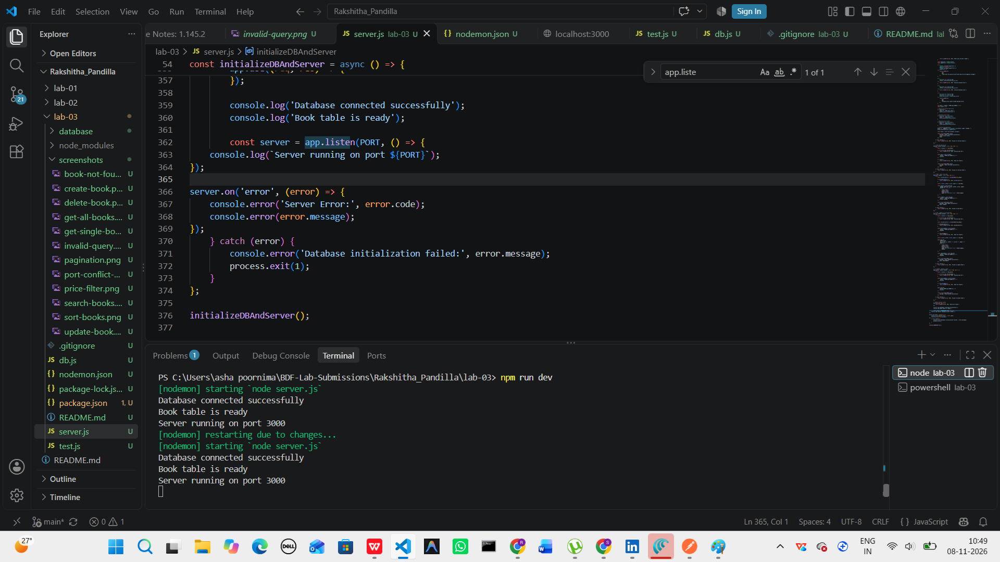

### 2. Wrong Import Path – MODULE_NOT_FOUND

- **Problem:** An incorrect database module path caused a module-not-found error.
- **Solution:** Corrected the import path to `./db`.

**Before fixing:**

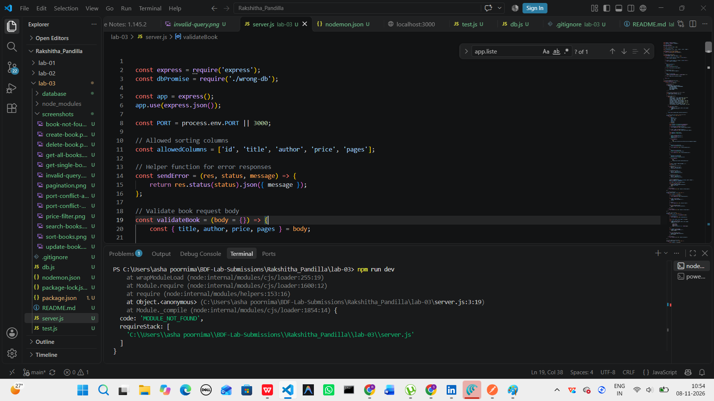

**After fixing:**

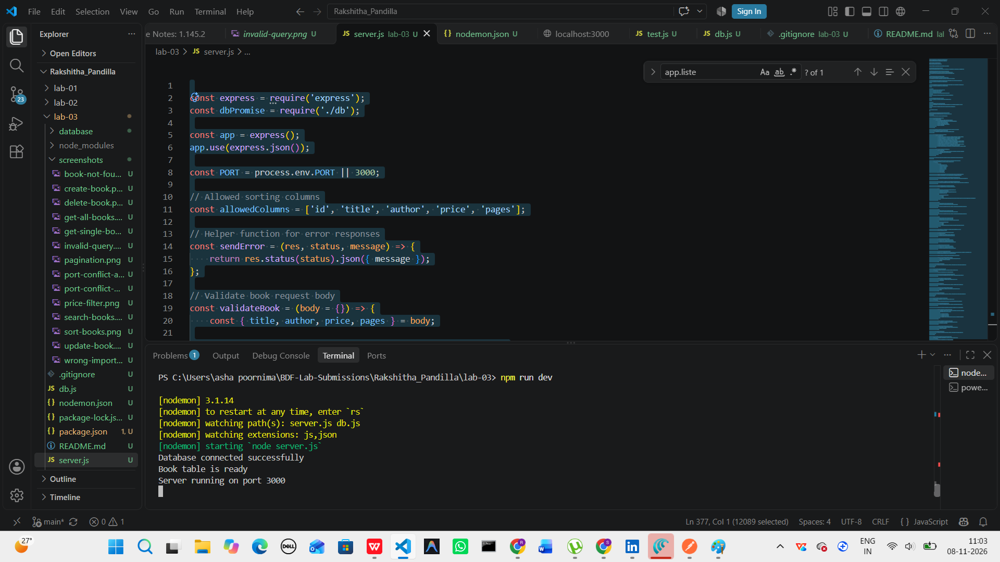

### 3. Incorrect Table Name – no such table

- **Problem:** Using `books` instead of the actual table name `book` caused an SQLite error.
- **Solution:** Corrected the SQL query to use the proper table name.

**Before fixing:**

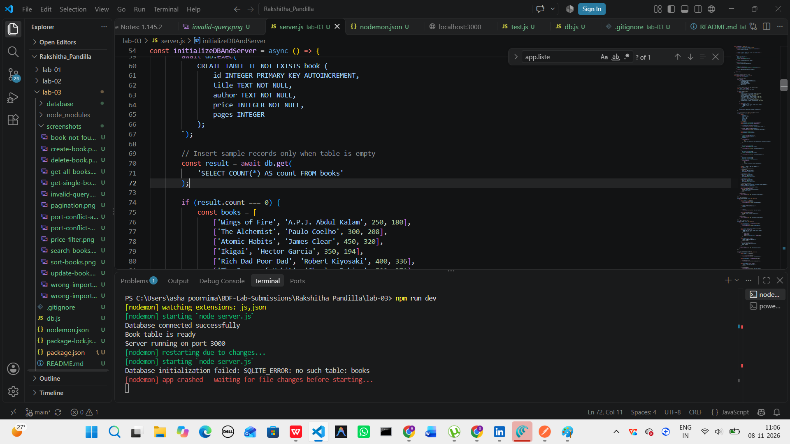

**After fixing:**

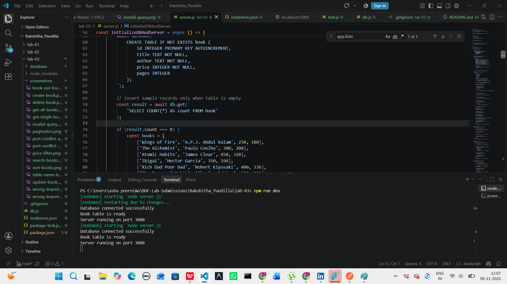

### 4. Missing await

- **Problem:** Calling an asynchronous database operation without `await` returned a Promise instead of the actual query result.
- **Solution:** Used `await` to wait for the database operation to complete and retrieve the result.

**Debugging output:**

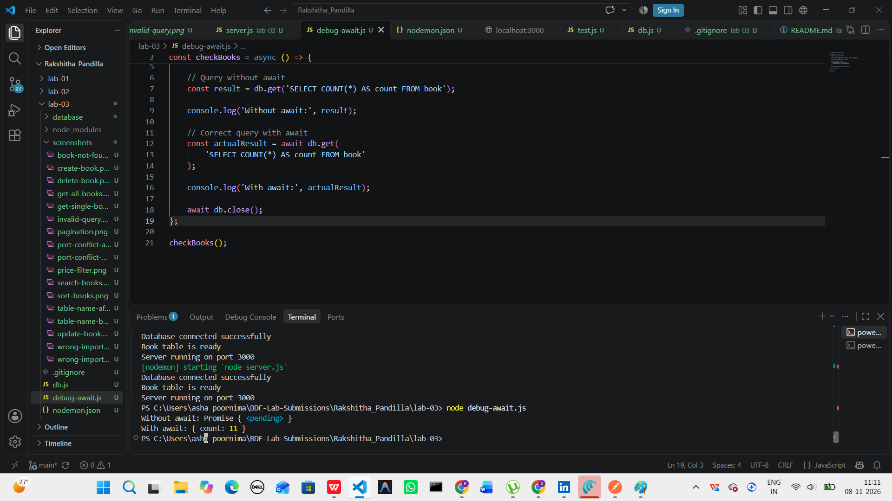

## 11. Conclusion

Successfully developed a RESTful Book API using Node.js, Express.js and SQLite. Implemented CRUD operations, search, sorting, pagination, price filtering, input validation, appropriate HTTP status codes and error handling.

Also reproduced and resolved four common debugging scenarios involving port conflicts, incorrect import paths, SQL table-name errors and missing `await`. Tested the API using Postman to verify its functionality.